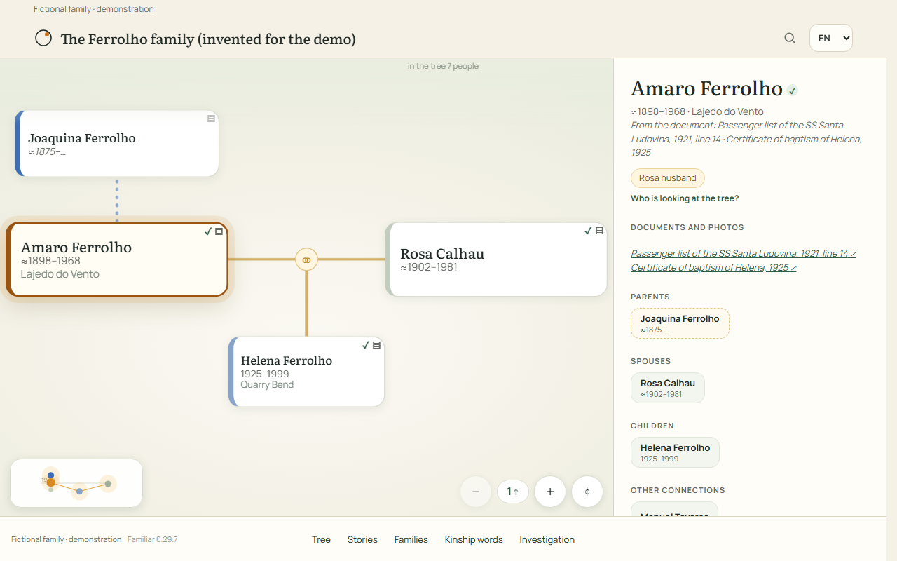

# Familiar

Living history of a family, researched and told by agents.

**[Open the invented family →](https://applerom.github.io/familiar/)** ·
MIT · active development, no stable version yet

A familiar is a companion that acts on its own. It searches records, compares
hands, weighs versions, restores the setting of a place and time, and writes
scenes a grandparent can read aloud. Every scene stands on a document; the
reasoning is one tap away.

<p>
  
  
</p>

The pictures show the invented family that ships in [`demo/`](demo/README.md);
the same pages are [live here](https://applerom.github.io/familiar/).

## What a family gets

- **A tree that grows from memory.** It starts from what relatives remember
  and keeps every fact attributed: told, read in a paper, or a weighed version
  drawn as a dotted line until a document settles it.
- **Research that leaves a trail.** Where was looked, for whom, in which
  spelling, how carefully — and what is still unread. A zero without a control
  is never taken for an absence.
- **Stories, not reports.** Scenes with the world around a person's fate, a
  layer for children, documents as small cut-outs with a literal reading.
- **Pages relatives open on a phone.** A local reader and a narrator's desk;
  optionally a private site behind logins; a print book.
- **Privacy by construction.** Living people show a name and kinship and
  nothing else unless consent is recorded; addresses and documents of the
  living never leave the family directory.

## How it is used

You do not operate Familiar — your agent does. You need an agent that can run
shell commands (Claude Code, Codex or another) and one subscription. No cloud
account, no server, no Node. Say to the agent:

> Install Familiar from https://github.com/applerom/familiar, read its README
> section "For agents", and start a family in `./my-family`. I will tell you
> what I remember.

From there you tell memories, hand over home papers, read what the agent
wrote and say what is wrong. The agent keeps the family's files, searches at a
person's pace and shows you the result on `localhost`. The family directory
is yours and private: Familiar has no service, no account and no telemetry.

## For agents

You are the intended reader of this repository.

1. **Walk the first family:** [docs/first-family.md](docs/first-family.md) —
   install a tagged release, create an instance, take in memory and a paper,
   build the tree, write and review the first story, open the reader and the
   desk. Every step is a command.
2. **Entry skill:** [agent-skill/familiar/SKILL.md](agent-skill/familiar/SKILL.md)
   routes you into the method shipped inside the installed engine. Do not copy
   the method out of the repository; read it from the engine you run:

   ```sh
   familiar method list
   familiar method show role researcher
   familiar --root ./my-family rules for researcher
   familiar research form memory.toml
   ```
3. **Know the layers:** [docs/architecture.md](docs/architecture.md) — what the
   engine does, what belongs to the host's environment (your web access,
   logins, subscriptions), where every setting and secret lives, who issues
   logins to relatives.
4. **Upgrade deliberately:** [docs/upgrading.md](docs/upgrading.md) — install
   tags, not `main`; the family pins its engine; `Data:` lines in the changelog
   name every carry-over.

Rules that hold in every role:

- The host chooses the family root. Pass `--root` on every family command;
  never pick a family you discovered on disk.
- Write to the family through engine commands. Sources stay literal;
  uncertainty stays visible; a record, an identity and a kinship are three
  separate statements.
- You do not send, publish or sign in for the host. Letters are drafts; a
  captcha or a login stops that source until the host acts.
- Never identify a person by a matching name alone.

Try the invented family from a checkout, without creating anything:

```sh
uv run familiar --root demo family summary
uv run familiar --root demo feed pages ferrolho --text --page amaro-1921
uv run familiar --root demo family next
```

## What is not here

- **Live access to archives and sites.** The engine carries source cards and
  recipes; your agent fetches pages with its own tools under your sessions.
- **Orchestration of many agents and subscription budgeting.** One agent is
  the supported path. Running several is the host's own environment
  ([why](docs/architecture.md#the-host-environment-by-size)).
- **A hosted service.** Optional publication goes to the host's own AWS
  account (`eu-north-1` only for now), behind logins the host issues.

## Where things stand

- The method was proven on real families that stay private; this repository
  holds only invented ones: [demo/](demo/README.md) (English) and
  [demo-russian/](demo-russian/README.md).
- One region pack so far: Belarus and the Podlaskie borderland. Language
  packs: Russian, Polish, Latin register cues, demo English. A family from
  elsewhere works, with less help from the pack — a new pack is the most
  useful contribution ([regions/CONTRACT.md](regions/CONTRACT.md)).
- Developed on Windows; installation and the demo build are also checked on Linux.
- Product and boundaries: [docs/PRD.md](docs/PRD.md). Changes:
  [CHANGELOG.md](CHANGELOG.md).

## Working on the engine

Read [AGENTS.md](AGENTS.md), then [CONTRIBUTING.md](CONTRIBUTING.md).
`uv run pytest -q` while working, `uv run pytest -q --full` once before done.
Privacy and security reports: [SECURITY.md](SECURITY.md).

## License

MIT — see [LICENSE](LICENSE). Bundled third-party material keeps its own
notices: [THIRD_PARTY_NOTICES.txt](THIRD_PARTY_NOTICES.txt).
