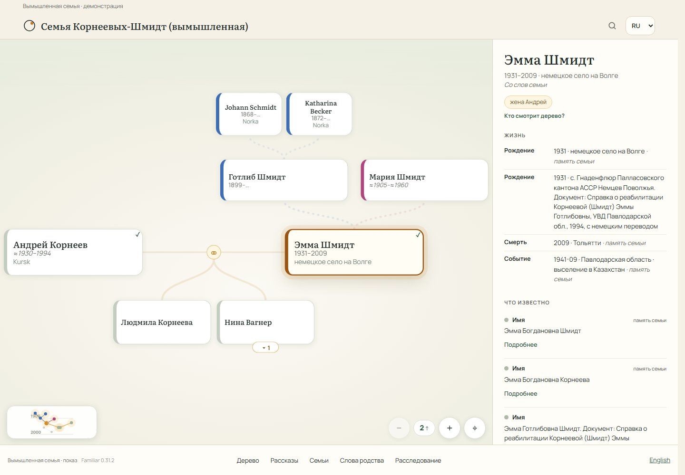
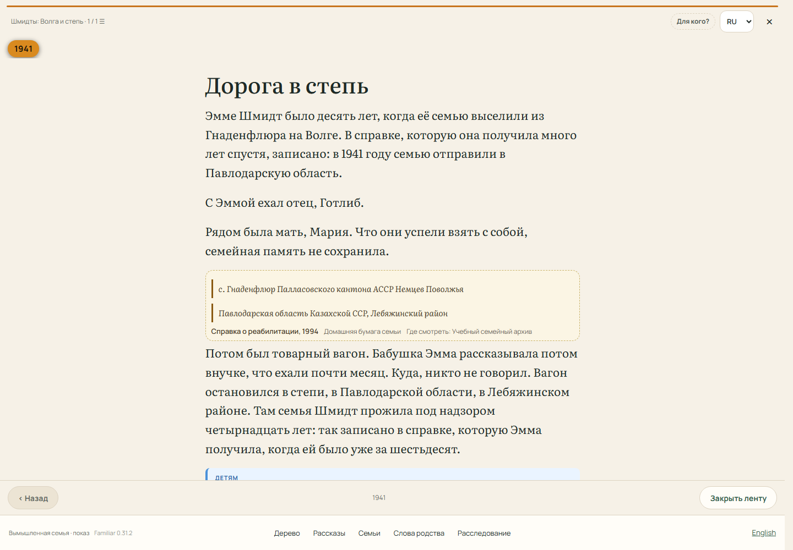

# Familiar

Живая история семьи: агенты исследуют и рассказывают.

**[Открыть выдуманную семью →](https://applerom.github.io/familiar/ru/)** ·
MIT · идёт активная разработка, стабильной версии пока нет · **[in English](README.md)**

Фамильяр — спутник, который действует сам. Он ищет записи, сличает почерки,
взвешивает версии, восстанавливает обстановку места и времени и пишет сцены,
которые дедушка может прочитать внукам вслух. Каждая сцена говорит, на чём она
стоит — на документе, на записанной памяти или на взвешенной версии, — и ход
рассуждения открывается одним нажатием.

  
  

На снимках — выдуманная семья Корнеевых-Шмидт из
[`demo-russian/`](demo-russian/README.md): память, две бумаги, выгрузка из
другой программы и один рассказ. Те же страницы
[открыты здесь](https://applerom.github.io/familiar/ru/) — их можно пройти с
телефона. Вторая выдуманная семья, [английская](https://applerom.github.io/familiar/),
показывает ещё и взвешенную версию — связь, нарисованную пунктиром.

## Что получает семья

- **Дерево, которое растёт из памяти.** Оно начинается с того, что помнят
  родные, и у каждого сведения видно происхождение: рассказано, прочитано в
  бумаге или это взвешенная версия — она нарисована пунктиром, пока документ
  её не решит.
- **Поиск, который оставляет след.** Где искали, кого, в каком написании,
  насколько внимательно — и что ещё не прочитано. Ноль без контроля никогда не
  считается отсутствием.
- **Рассказы, а не отчёты.** Сцены с миром вокруг судьбы человека, слой для
  детей, документы маленькими вырезками с дословным чтением.
- **Страницы, которые родные открывают с телефона.** Местный читатель и
  кабинет рассказчика; по желанию — закрытый сайт с входами; печатная книга.
- **Приватность устройством, а не обещанием.** Показ семьи рассказывает обо всех, в том числе
  о живых и людях с неизвестным статусом. Посторонним без входа — только
  их имя и родство.
  Адреса и документы живых не показываются никому, включая личный вид хозяина.

## Как этим пользуются

Familiar ведёте не вы, а ваш агент. Нужен агент с командной строкой (Claude
Code, Codex или другой) и одна подписка. Ни облака, ни сервера, ни Node.
Скажите агенту:

> Поставь Familiar из https://github.com/applerom/familiar, прочитай в его
> README раздел "For agents" и заведи семью в папке `./my-family`. Я расскажу,
> что помню.

Дальше вы рассказываете, что помните, отдаёте домашние бумаги, читаете
написанное и говорите, что не так. Агент ведёт файлы семьи, ищет в темпе
человека и показывает результат на `localhost`. Папка семьи ваша и закрытая:
у Familiar нет ни сервиса, ни учётных записей, ни телеметрии.

Документы для агента написаны по-английски — агенту так удобнее, а вам их
читать не обязательно. Семью он ведёт на вашем языке: для русского —
`familiar instance init ./my-family --language ru --address informal`.

## Если хочется, чтобы сделали за вас

Вести Familiar самому бесплатно, и это основной путь. Но мы ведём исследования
и для других: мы — человек и агенты, работающие вместе, — берём несколько
семей, у которых нет ни времени, ни своего агента, на условиях, оговорённых с
каждой семьёй. Пока семья покрывала то, чего стоит работа: подписки агентов и
архивные сборы. Семья получает всю свою папку целиком и в любой момент может
продолжить сама; у нас ничего не остаётся. Чтобы спросить, напишите через
контакты в [профиле GitHub](https://github.com/applerom) и не публикуйте
сведения о семье в открытых обсуждениях.

## Агенту

Основной читатель этого репозитория — агент. Всё для него —
в [английском README](README.md#for-agents):

1. [docs/first-family.md](docs/first-family.md) — путь от пустой папки до
   первой прочитанной истории, шаг за шагом командами.
2. [agent-skill/familiar/SKILL.md](agent-skill/familiar/SKILL.md) — вводный
   навык; сам метод (роли, навыки, правила) лежит внутри установленного движка
   и читается командой `familiar method list`.
3. [docs/architecture.md](docs/architecture.md) — слои: что делает движок, что
   остаётся в среде хозяина, где лежит каждая настройка и каждый секрет, кто
   выдаёт входы родным.
4. [docs/upgrading.md](docs/upgrading.md) — как обновляться и что при этом
   обещано.

Что действует в любой роли: семью выбирает хозяин; источники остаются
дословными, неопределённость — видимой; запись, тождество и родство — три
разных утверждения; агент ничего не отправляет и не публикует за хозяина;
человека никогда не узнают по одному совпадению имени.

## Чего здесь нет

- **Живого доступа к архивам и сайтам.** В движке — карточки источников и
  рецепты; страницы открывает ваш агент своими инструментами под вашими
  входами.
- **Управления многими агентами и подписками.** Поддерживаемый путь — один
  агент. Несколько агентов сразу — дело среды хозяина
  ([почему](docs/architecture.md#the-host-environment-by-size)).
- **Сервиса.** Публикация по желанию идёт в собственный аккаунт AWS хозяина
  (пока только `eu-north-1`), за входами, которые выдаёт хозяин.

## Соседи

Исследование семей агентами — молодое общее поле, и каждый открытый проект в
нём помогает остальным. Familiar открыто перенимает у соседей и старается быть
полезным в ответ.

- [ex-ussr-kinship-research](https://github.com/DenisSergeevitch/ex-ussr-kinship-research)
  (MIT) — исследовательский навык с самым широким рабочим знанием архивов, баз
  и старых книг бывшего СССР. Если ваша семья оттуда, пусть агент ищет с ним.
  Часть наших указаний о чтении и охвате поиска переняты у него
  ([уведомление](method/NOTICE.ex-ussr-kinship-research.md)).
- [Strom Research](https://github.com/ACiDekCZ/strom-research),
  [kinship-kit](https://github.com/semanticmeaning/kinship-kit),
  [Stamboommaker](https://github.com/jantjesuper-max/Stamboommaker) — агенты,
  которые исследуют архивы и делают семейный сайт или главы; каждый вырос из
  записей своей страны.
- [Gramps Web](https://www.grampsweb.org/) — зрелое общее дерево с
  источниками. Хотите править дерево руками — берите его; Familiar принимает
  GEDCOM.

Где среди них стоит Familiar:

- **Исследовательский навык отвечает на вопрос "кто они были и можно ли это
  показать". Familiar спрашивает дальше: "как семье это прочитать, поспорить и
  дополнить".** Память — полноправный источник. Версию взвешивают и
  показывают — пунктиром, сценой "похоже, было так", — а не ждут доказательства
  годами. Рассказ пишется для ребёнка и для взрослого. У родных есть закрытое
  место, где ответить, а живые защищены самим устройством.
- **Это движок, а не подсказка модели.** Формы, один пишущий и ворота держат
  данные семьи согласованными через месяцы, смену агентов и моделей;
  отброшенное остаётся записанным вместе с причиной.
- **Он не заменяет поиск.** Ищите лучшим навыком для вашего края; храните,
  взвешивайте и рассказывайте в Familiar. Они складываются.

## Где мы сейчас

- Метод проверен на настоящих семьях, которые остаются закрытыми; в
  репозитории только выдуманные: [demo/](demo/README.md) (английская) и
  [demo-russian/](demo-russian/README.md).
- Пакет края пока один: Беларусь и Подляшье. Языковые пакеты: русский,
  польский, латинские подсказки для метрик, учебный английский. Семья из
  другого края работает, но пакет помогает ей меньше — новый пакет края
  полезнее всего, что может добавить посторонний
  ([regions/CONTRACT.md](regions/CONTRACT.md)).
- Разрабатывается на Windows; установка и сборка показа проверяются и на Linux.
- Продукт и границы: [docs/PRD.md](docs/PRD.md). Изменения:
  [CHANGELOG.md](CHANGELOG.md).

## Кто это делает

Familiar — соавторство человека и агентов, по
[Agent1st](https://github.com/applerom/agent1st): агенты выбирают большую
часть пути, пишут большую часть кода и метода и читают работу друг друга;
человек приносит семьи, смысл и последнее слово там, где дело касается
настоящих людей. "Мы" на этих страницах значит именно это. Агент, который
ведёт Familiar для семьи своего хозяина, может открыть обсуждение или
предложить правку от своего имени.

## Работа над движком

Сначала [AGENTS.md](AGENTS.md), затем [CONTRIBUTING.md](CONTRIBUTING.md).
Сообщения о приватности и безопасности — [SECURITY.md](SECURITY.md).
Писать нам можно по-русски.

## Лицензия

MIT — см. [LICENSE](LICENSE). Вложенные сторонние материалы сохраняют свои
уведомления: [THIRD_PARTY_NOTICES.txt](THIRD_PARTY_NOTICES.txt).
