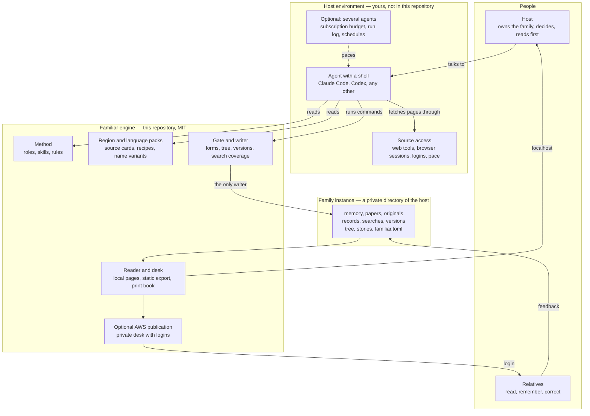

<!-- PURPOSE: One page that says what this repository is, what it deliberately is not, and where every setting and secret lives. -->
# Layers: what is here and what is not

Familiar is used through an agent. The person whose family it is (the **host**)
talks to an agent; the agent runs the engine; the engine keeps the family's
data honest and turns it into pages relatives can read. Nothing in this
repository is meant to be operated by clicking: the two web surfaces (reader
and desk) are for *reading and answering*, not for running research.

## Four layers

| Layer | What it holds | Who owns it | Public |
|---|---|---|---|
| **Engine** (this repository) | method, forms, packs, gate, reader, desk, optional AWS publication, two invented families | the project | yes, MIT |
| **Family instance** | everything one family told and everything found for it; `familiar.toml` with the engine pin | the host | never; private directory, private backup |
| **Host environment** | the agent and its subscription, web access, site logins, browser profile, AWS profile | the host | never |
| **Maintainers' process** | how this project itself is developed: roadmap, release rolls, watching related open projects | the maintainers | no; it is a way of working, not a product |

The engine is the only layer you need to take from here. The other three are
yours, and the engine is built so that they stay yours.

## What the engine deliberately does not know

- **Subscriptions, models, the number of agents.** The engine never reads a
  limit, starts an agent or chooses a model. The one trace it keeps is plain
  data in the search journal: who looked (`by.agent`, `by.model`, `by.effort`),
  so `research coverage` can say how strongly a source was read.
- **Live access to sources.** The engine ships source cards and recipes in the
  region pack and replays a saved capture (`research replay`). Fetching a page
  is the agent's own tool, under the host's sessions and permissions. A
  challenge or refusal stops that source; an unread answer is never a zero.
- **Credentials.** See the map below: none of them lives in the engine, and the
  family instance holds only the ones the engine itself generated.
- **Sending anything.** Letters to archives and messages to relatives are
  drafts. The host sends them. Publication is the host's explicit action.

## The host environment, by size

**One agent, one subscription — supported, the documented path.** The agent
reads its role (`familiar method show role researcher`), takes source cards
from the pack, fetches pages with its own web tools at a person's pace, and
records every pass through the search form. Nothing else is needed. The
independent reading that a story requires is done by the host or another
person, not by a second paid agent.

**Several agents at once — possible, not shipped.** Then three things appear
that a single agent never needs: one shared pace per site (so that five agents
do not look like a scraper), a run log (who is working on what), and a budget
for the subscriptions. These belong to the host environment. The maintainers
run their own private scripts for this; they are tied to particular machines
and subscriptions and are not part of Familiar. If they are published, it will
be as a separate project: an engine that knew about subscription windows would
have to change every time a provider changed a plan. The seam the engine
offers is data: the coverage ledger, saved captures and forms are plain files
that any orchestration can read and write through the same commands.

**Watching related open projects** is likewise the maintainers' process. What
was adopted from other projects is recorded where it landed (`method/NOTICE.*`,
`regions/*/NOTICE.md`, `THIRD_PARTY_NOTICES.txt`).

## Where every setting and secret lives

| What | Where | Notes |
|---|---|---|
| Family settings, languages, packs, engine pin | `<family>/familiar.toml` | plain text, versioned with the family |
| Who may see what (privacy, consent, desk decision) | `<family>/family/` | family data, read by the gate |
| Desk address, shared login and password, stack ids | `<family>/.secrets/desk.txt` | written by `desk provision`; git-ignored; never printed |
| First-sign-in passwords of personal logins | issued by `desk user add\|reset`: shown once and kept in `<family>/.secrets/desk-user-<login>.json`; issued on the Access page: shown once in the browser, stored nowhere locally | valid for a limited time, replaced at first sign-in |
| Who confirmed which page, and the host's desk decisions | `<family>/.state/attestations.json` and neighbours | not derivable; `.state/` is left out of the family's version control, so it must be in the backup |
| AWS account access | the AWS CLI's own store (profile, SSO) | the family names only the profile in `[publication]` |
| Logins to archives and genealogy sites | the host's browser profile or the agent's environment | never in the family, never in the engine |
| The agent's subscription | the agent's own sign-in | invisible to the engine |

Keep `.secrets/` and `.state/` in a private backup together with the family.
Losing `.secrets/` loses no family data, but the engine will not adopt an
existing AWS stack without its local state: restore the directory from the
backup. Losing `.state/attestations.json` returns every confirmed page to
"unread".

## Who administers relatives' access

The desk has two modes. Locally (`desk serve`) it opens on loopback without a
login and shows the host's full view. Published to AWS, it is closed: either
one shared login, or personal logins (`login = "personal"`).

Personal logins are issued by the host, never by self-registration:

- from the command line or through the agent — `familiar desk user add|list|reset|disable|enable|remove`;
- from the published desk itself — the **Access** page, visible to the
  `owner` role: find a person in the tree, issue a login, hand over the
  one-time password, reset or disable it later.

So a host who set Familiar up with an agent can afterwards hand out and revoke
logins from a phone, without the agent. There is no separate administration
site, no e-mail invitations and no roles beyond `owner` and `reader`
([details](family-desk.md)).

## Data flow in one line

memory and papers → `intake` → attributed tree → research (`records`,
`searches`, `versions`, coverage) → stories (`feed`) → independent reading →
`reader export` / `desk build` → local pages → optional publication.
Originals are copied byte for byte and never rewritten. Builds, exports and
caches can be rebuilt from the inputs; reading confirmations cannot.
